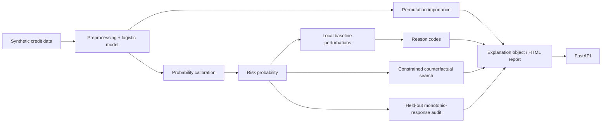

# Credit Default Explainability

A runnable explainable-credit-risk reference project combining **calibrated default probabilities, global permutation importance, local perturbation attribution, governed monotonic-response audits, reason codes and constrained counterfactual search**.

Everything runs on deterministic synthetic data. The project demonstrates model governance and explainability engineering; it is not a lending policy, legal adverse-action system or financial recommendation.

## Architecture



## Why this project is not just a SHAP screenshot

The repository separates several questions that are often incorrectly collapsed into one plot:

- **Is the probability calibrated?** The classifier is wrapped with sigmoid calibration and reports Brier score as well as ROC-AUC / average precision.
- **Which features matter globally?** Held-out permutation importance measures the drop in ROC-AUC when one raw feature is shuffled.
- **Why did this row receive this score?** A model-agnostic local perturbation replaces each feature with a training baseline and measures the probability change.
- **What small actionable changes move the model score?** A constrained greedy counterfactual search considers only a small allowlist of synthetic, potentially actionable variables.
- **Does the score respect declared domain directions?** A held-out monotonic-response audit sweeps governed numeric features across cohort quantiles in multiple fixed contexts and records opposing score movements.
- **What should a reviewer see?** The API returns structured reason codes, local sensitivities, probability, threshold and explicit caveats.

The local perturbation values are deliberately labelled as *model sensitivity*, not causal explanations or Shapley values.

## Synthetic features

```text
income
debt_ratio
late_payments
utilization
account_age_months
age
employment
housing
```

The synthetic target is sampled from a known nonlinear-ish risk function. This gives the public project a reproducible signal while avoiding real customer data.

## Quick start

```bash
python -m venv .venv
source .venv/bin/activate  # Windows: .venv\Scripts\activate
pip install -r requirements.txt
python -m creditxai.cli --rows 6000 --seed 42
```

Artifacts:

```text
artifacts/analysis.json
artifacts/report.html
artifacts/credit_risk.joblib
```

`analysis.json` includes the monotonicity audit configuration and per-feature
comparison counts, violation rates and worst opposing movement. It does not emit
the sampled applicant rows.

## Monotonic-response audit

The default audit declares expected directions for income, debt ratio, late
payments, utilization and account age. Age and categorical variables are excluded
from this governed set. For each feature, the audit derives a five-point grid from
held-out cohort quantiles, fixes all other values to each of up to 32 deterministic
contexts, and fails the feature when an adjacent score change opposes the declared
direction beyond a numerical tolerance.

These declarations describe the synthetic data-generating process; they are not a
lending policy. Passing establishes only bounded model-behavior consistency over
the evaluated cohort range. It does not establish causality, fairness or sensible
behavior for joint or out-of-distribution changes.

CI turns the report into a regression gate with
`--fail-on-monotonicity-violation`; the CLI returns exit status 2 when any governed
feature fails. Without that flag, violations remain inspectable report evidence.

## API

```bash
uvicorn app.api:app --reload
curl http://localhost:8000/demo
```

`POST /score` accepts one synthetic applicant and returns:

```text
default probability
review decision boundary
reason codes
per-feature local probability deltas
counterfactual candidate
methodological caveat
```

## Counterfactual constraints

The demo counterfactual search does **not** modify age, employment or housing. It only explores the allowlisted synthetic fields:

- utilization;
- debt ratio;
- late-payment count;
- income.

This is still not a recommendation engine. The purpose is to demonstrate how an explanation system can encode actionability constraints instead of allowing an optimizer to mutate every input indiscriminately.

## Docker

```bash
docker build -t credit-default-explainability .
docker run --rm -p 8000:8000 credit-default-explainability
```

## Tests / CI

```bash
ruff check .
pytest -q
python -m creditxai.cli --rows 2200 --fail-on-monotonicity-violation
```

CI trains the deterministic synthetic model, exercises the explanation and counterfactual paths, generates artifacts and builds the container.

## Governance / limitations

A high model score is not a legal lending decision. Permutation importance can be distorted by correlated variables; one-feature perturbations can create unrealistic combinations; monotonicity depends on domain assumptions and is only tested over bounded grids; and counterfactual feasibility is domain-specific. A real deployment would require fairness testing, policy controls, data lineage, monitoring, protected-class review, legal validation and human oversight.

## Portfolio signal

**Python · scikit-learn · probability calibration · XAI · monotonicity audits · permutation importance · counterfactual explanations · model governance · FastAPI · Docker · CI/CD**
